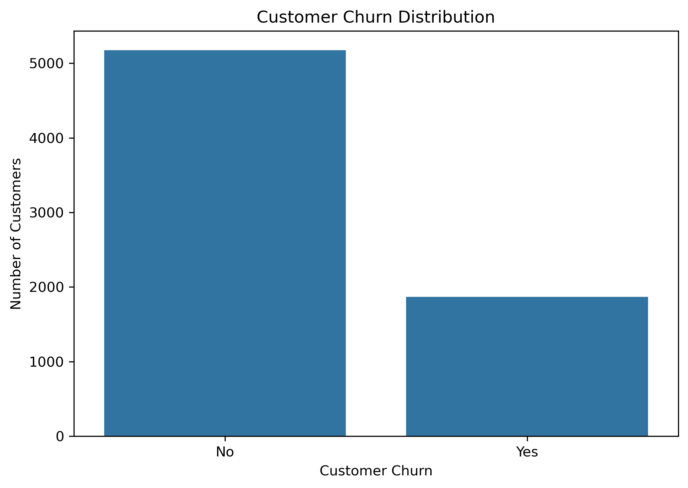
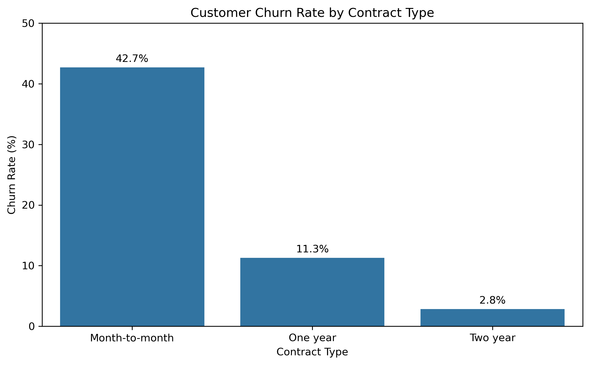
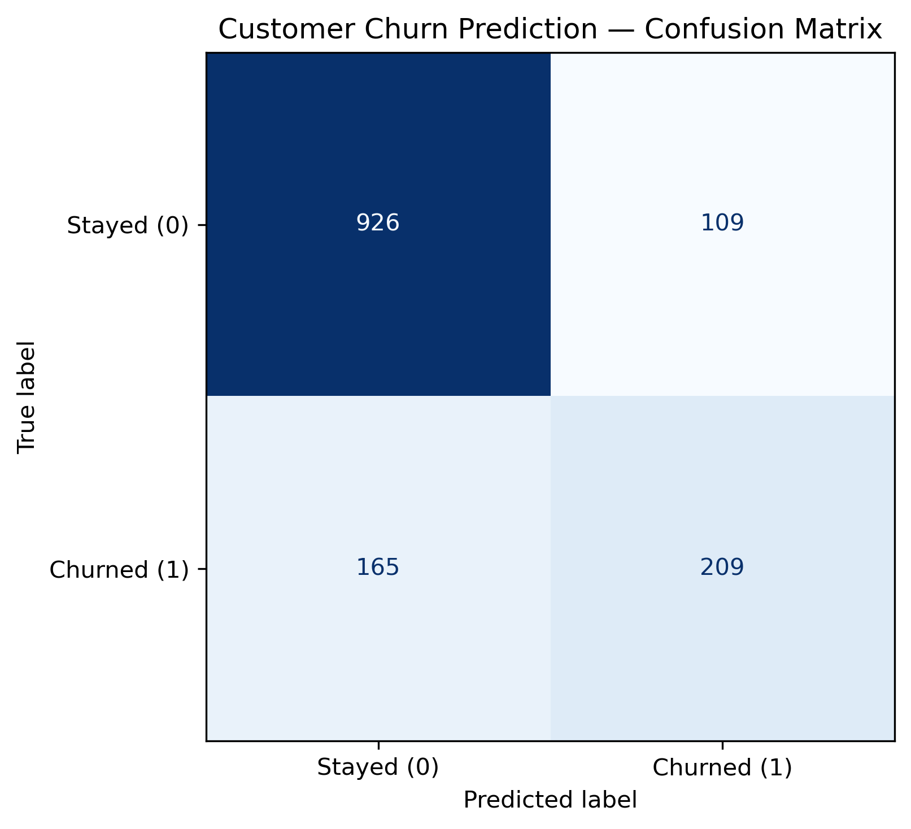
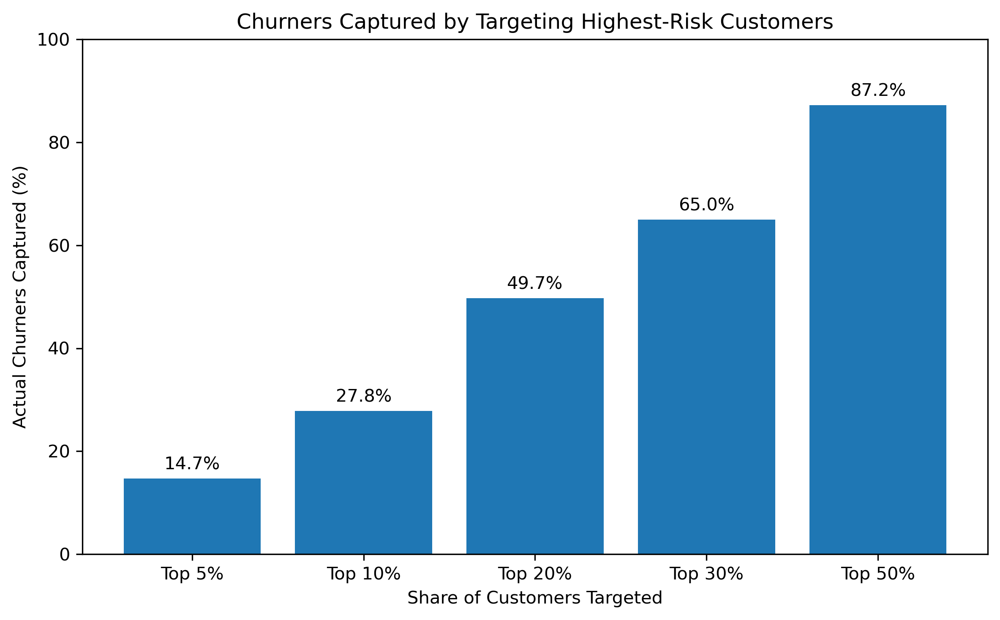

# Customer Churn Prediction

## Project Overview

Customer churn is a major challenge for telecommunications companies. Identifying customers who are likely to leave can help businesses prioritize retention efforts and allocate their resources more effectively.

In this project, I developed a machine learning workflow to predict customer churn using a public telecommunications customer dataset. I explored customer behavior, compared multiple classification models, evaluated different prediction thresholds, and translated the findings into potential retention strategies.

**The goal was not only to predict churn, but also to understand how predictions could support business decisions.**

## Business Problem

The business needs to identify customers who are likely to discontinue their services so that the retention team can prioritize outreach within a limited budget.

This project addresses three questions:

- Which customer characteristics are associated with churn?
- How effectively can a machine learning model identify potential churners?
- How can churn predictions be used to prioritize retention efforts?

## Dataset

The project uses the Telco Customer Churn dataset, a publicly available dataset commonly used for churn analysis.

- **Total records:** 7,043 customers
- **Target variable:** `Churn`
- **Original features:** 20 customer attributes, excluding the customer ID
- **Target distribution:** Approximately 26.5% churned and 73.5% did not churn

The dataset includes customer demographics, tenure, contract type, payment method, internet services, additional services, and billing information.

## Methodology

### 1. Exploratory Data Analysis

I investigated churn patterns across customer segments, including:

- Contract type
- Tenure
- Internet service
- Payment method
- Technical support and online security
- Monthly and total charges

I also explored interactions between customer characteristics to identify segments with elevated observed churn rates.

### 2. Data Preprocessing

The preprocessing workflow included:

- Converting `TotalCharges` to a numeric data type and handling missing values.
- Separating the target variable from the input features.
- Excluding the customer ID from model training.
- Using a stratified 80/20 train-test split.
- Applying median imputation and standardization to numerical features.
- Applying most-frequent imputation and one-hot encoding to categorical features.

Preprocessing was implemented using scikit-learn pipelines to help prevent information leakage between training and test data.

### 3. Model Development and Comparison

I evaluated three model families:

- Logistic Regression
- Random Forest
- Histogram-based Gradient Boosting

I used stratified five-fold cross-validation to compare model performance using ROC-AUC. I also evaluated different regularization strengths for Logistic Regression.

Logistic Regression achieved the strongest mean cross-validation ROC-AUC among the tested model configurations while providing a relatively interpretable baseline.

### 4. Threshold Selection

Rather than relying exclusively on the default probability threshold of 0.50, I evaluated alternative thresholds using out-of-fold predictions generated from the training data.

A threshold of 0.35 was selected because it produced the highest F1 score among the thresholds tested.

This choice favors identifying more potential churners, while accepting additional false positives. The threshold is a candidate business setting, not a universally optimal choice.

### 5. Model Evaluation

The selected Logistic Regression model was evaluated on a held-out test set that was not used to select the threshold.

| Metric | Test Result |
|---|---:|
| ROC-AUC | 0.8419 |
| Precision | 54.4% |
| Recall | 70.6% |
| F1 score | 61.5% |
| Accuracy | 76.5% |

At the selected threshold, the model identified 264 of the 374 actual churners in the test set.

It also generated 221 false positives, highlighting the trade-off between identifying potential churners and contacting customers who ultimately did not churn.

### 6. Customer Risk Ranking

I ranked test-set customers by their predicted churn probabilities to evaluate how effectively the model concentrated churners among the highest-risk customers.

When targeting the top 10% of customers:

- Customers targeted: 140
- Actual churners among those targeted: 104
- Precision: 74.3%
- Share of all test-set churners captured: 27.8%

This demonstrates the potential value of using model rankings to prioritize a limited outreach budget.

These results describe retrospective performance on the held-out test set, not the expected impact of a real retention campaign.

## 7. Visualizations

### 1. Customer Churn Distribution

### 2. Churn Rate by Contract Type

### 3. Confusion Matrix

### 4. Customer Targeting Performance

## Key Findings

The analysis identified several customer characteristics associated with elevated churn risk.

- **Contract type:** Month-to-month customers showed substantially higher observed churn than customers on longer-term contracts.
- **Tenure:** Customers with shorter tenure had higher observed churn. The median tenure in the model-defined high-risk group was 9 months, compared with 46 months in the lower-risk group.
- **Internet service:** Fiber-optic customers were overrepresented in the high-risk group.
- **Payment method:** Electronic-check users were substantially more prevalent in the high-risk group.
- **Additional services:** High-risk customers frequently lacked TechSupport and OnlineSecurity.
- **Monthly charges:** The high-risk group had higher median monthly charges than the lower-risk group.

These findings describe associations in the dataset. They do not establish that any individual characteristic directly causes churn.

## Business Recommendations

Based on the analysis, I identified three potential retention strategies.

### 1. Early-Tenure Retention

Prioritize high-risk, newer customers, particularly those on month-to-month contracts. Test targeted contract incentives and relevant service offers.

### 2. Payment-Method Campaign

Test a voluntary payment-method migration campaign among eligible high-risk electronic-check users. Measure whether the campaign reduces churn enough to justify its cost.

### 3. Customer Onboarding and Value Demonstration

Test personalized onboarding, plan reviews, and service education for newer customers with higher monthly charges before resorting to blanket discounts.

The effectiveness of these interventions must be established through controlled experiments rather than inferred from predictive associations alone.

## Tools and Technologies

- Python
- Pandas
- NumPy
- Matplotlib / Seaborn
- scikit-learn
- Jupyter Notebook
- Git and GitHub

## Limitations and Future Work

### Limitations
- **Dataset representativeness:** This project uses a public telecom churn dataset, so the findings may not generalize to every telecom business.
- **Evaluation strategy:** A random train-test split was used. Temporal validation would provide a stronger assessment of performance on future customers if appropriately dated data were available.
- **Threshold selection:** The classification threshold was selected using F1 score. A real business decision should also consider intervention costs, customer value, and the cost of missed churners.
- **No causal evidence:** The model identifies customers at elevated churn risk but does not establish whether a specific retention intervention will prevent churn.
- **Unvalidated deployment readiness:** Probability calibration, temporal generalization, and retention campaign effectiveness have not been established.

### Future Work
- Evaluate the model using time-based validation on appropriately dated data.
- Assess probability calibration.
- Select decision thresholds using business costs and expected customer value.
- Run controlled retention experiments to measure incremental impact.
- Monitor model performance and data drift if the model is deployed.

## Conclusion

This project demonstrates an end-to-end customer churn analysis workflow, from exploratory data analysis and preprocessing through model comparison, evaluation, customer ranking, and business recommendations.

The main takeaway is that machine learning can help prioritize potential churners, but successful retention requires more than predictive accuracy. Business constraints, intervention costs, and experimental evidence are essential to determine whether the resulting actions create value.
